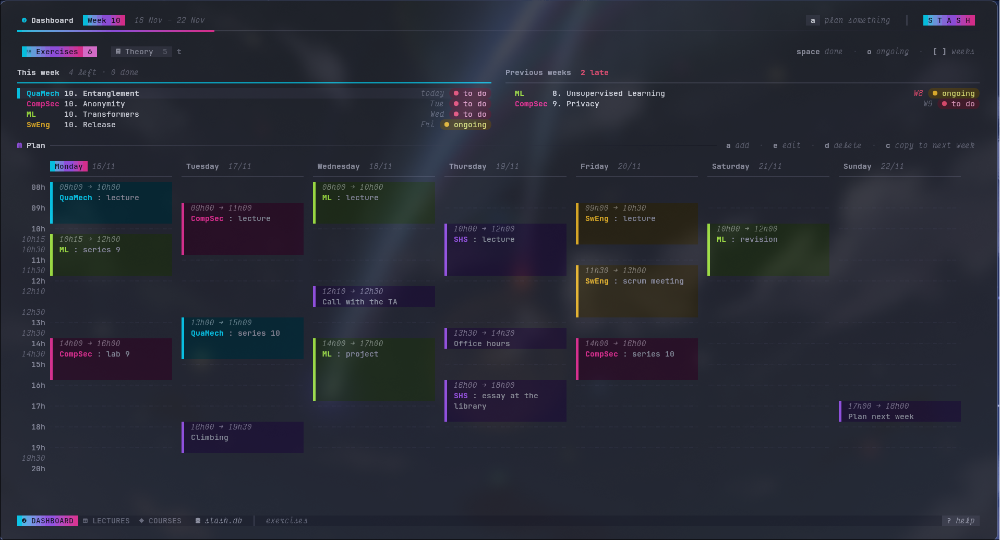
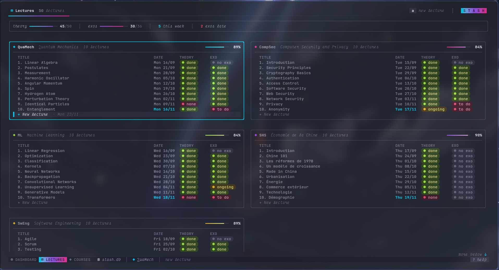
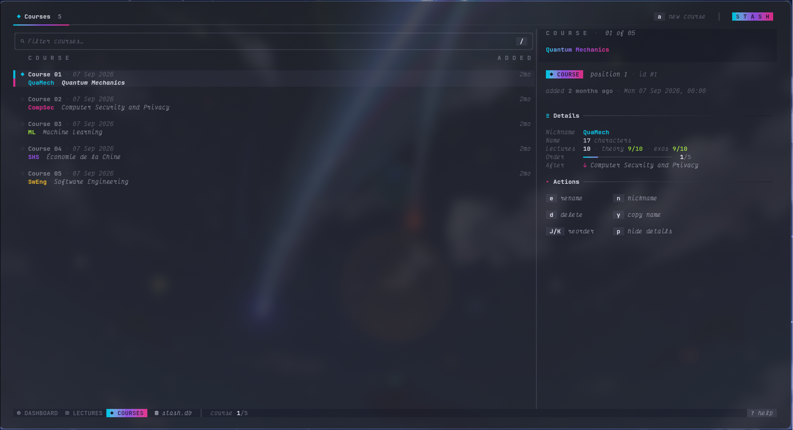

# stash

A fast terminal dashboard for your semester: what is due this week, what is
late, and when you will do it.

stash replaces a Notion page that had become too slow to use. It opens
instantly, works from the keyboard, and keeps everything in a single SQLite
file.



## Features

**Dashboard**: the week at a glance.

- The semester's week number, worked out from your lectures. Nothing to set
  up: the first lecture is week 1, and after three weeks without any
  lecture (the holidays), the next one starts week 1 again.
- The work due this week and the work left over from previous weeks, for
  exercises and for theory, ticked off with a single key.
- A weekly planner on a shared time axis. Each plan sits at its hour and its
  height follows its duration, so the week reads like a calendar.

**Lectures**: each course with its lectures, one per week, with date,
theory and exercise status. New lectures are numbered and dated a week after
the previous one. Each lecture has its own Markdown notes, written in a side
pane and saved as you type.



**Courses**: add, rename, reorder and filter courses, and give them short
nicknames (*Computer Security and Privacy* becomes *CompSec*) that are used
everywhere, including to colour plans that mention them.



## Install

stash needs [Go](https://go.dev/dl/) 1.26 or later.

```sh
go install github.com/nestama4real/stash@latest
```

The binary lands in `$(go env GOPATH)/bin`; make sure it is on your `PATH`.
Or build it from a clone:

```sh
git clone https://github.com/nestama4real/stash
cd stash
go build -o ~/.local/bin/stash .
```

stash uses a few [Nerd Font](https://www.nerdfonts.com/) icons, and looks
best in a terminal with a Nerd Font and true colour. It draws no background
of its own, so your terminal's background, wallpaper included, shows
through.

## Try it

```sh
stash --demo
```

opens a throwaway database with a typical week: five courses in week 10,
four lectures due, a little late work and a busy planner. Your own data is
left alone.

## Use

Run `stash`. `tab` and `shift+tab` move between the dashboard, lectures and
courses, and `?` shows every key of the current view.

The keys you will use most on the dashboard:

| Keys | Action |
| --- | --- |
| `1` … `7` | Plan something on Monday … Sunday |
| `8 10` `space` | … from 8h to 10h, then type what to do and press `enter` |
| `ctrl` + arrows | Move between this week, previous weeks and the planner |
| arrows | Move within one of them |
| `space` | Mark the selected lecture's exercises (or theory) as done |
| `x` / `t` | Show exercises / theory |
| `[` / `]` | Previous / next week |
| `#` | Correct the week number, if your semester counts differently |

In the lectures view, `a` adds a lecture to the selected course, `t` and `x`
cycle theory and exercise status, and `[` `]` move a lecture's date by a day.
`enter` opens the selected lecture's notes beside the list: write in
Markdown, there is nothing to save, and `esc` closes them. Lectures with
notes show a ✎.

Every text field edits like a shell prompt: arrows, `ctrl+←` `ctrl+→` by
word, `ctrl+w` to delete a word, `ctrl+u` to clear.

## Data

Everything lives in one SQLite database:

- `$STASH_DB`, if set;
- otherwise `$XDG_DATA_HOME/stash/stash.db`, that is
  `~/.local/share/stash/stash.db` by default.

Back it up by copying that file.

## Development

```sh
go test ./...
go run . --demo
```

Built with [Bubble Tea](https://github.com/charmbracelet/bubbletea),
[Lip Gloss](https://github.com/charmbracelet/lipgloss) and
[modernc.org/sqlite](https://modernc.org/sqlite) (pure Go, no cgo).
